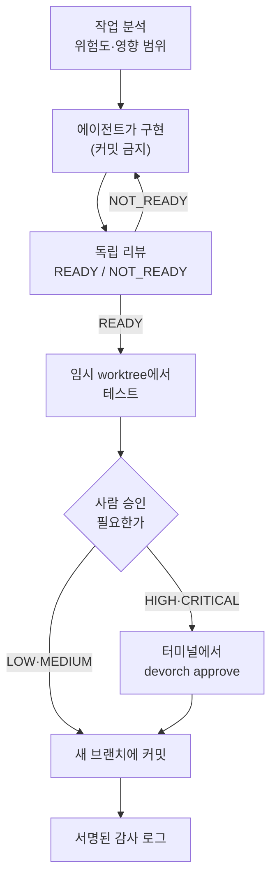
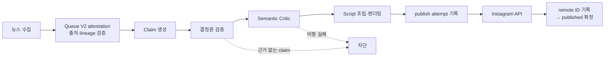
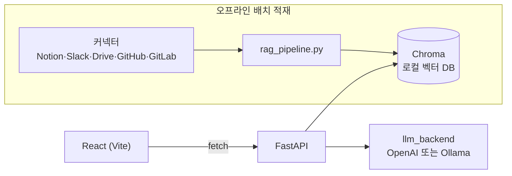

# 박윤후 · Park Yunhu

**AI Engineer (신입)** — LLM Agent · RAG · 검증/평가 · Backend  
2027.02 졸업예정 · [Portfolio](https://park-yunhu-portfolio.vercel.app) · [byunhu35@gmail.com](mailto:byunhu35@gmail.com)

`LLM Agent` `MCP` `RAG` `Fail-closed` `근거 검증` `평가·측정` `Python` `FastAPI` `TypeScript` `Next.js`

---

## Selected Projects

| 프로젝트 | 한 줄 | 핵심 근거 | 스택 |
|---|---|---|---|
| [**devorch**](https://github.com/YunhuPark/devorch) | AI 코딩 에이전트의 변경을 리뷰·테스트·사람 승인 후에만 반영하는 MCP 서버 | 개인 개발 · 커밋 100+ · CI 통과 · 실제 결함 12개로 리뷰어 탐지율 측정(5/12), 한계 공개 | Python · MCP · Docker |
| [**topic-ai**](https://github.com/YunhuPark/topic-ai) | Notion·Slack·Drive·GitHub·GitLab 통합 검색 RAG 어시스턴트 | 이스트소프트 OJT 팀 최종 결과물 · 핵심 검색 3일 구현 · OAuth 권한 필터 · OpenAI↔Ollama 전환 | FastAPI · LangChain · Chroma · React |
| [**algo-pipeline**](https://github.com/YunhuPark/algo-pipeline) | 근거에 연결된 주장만 카드뉴스로 만들어 게시하는 LLM 에이전트 | 개인 개발 · 커밋 70+ · 규칙 검증 → 의미 비평 → 게시 · 자동 게시 기본 OFF · CI 통과 | Python · FastAPI · SQLite |
| [**Medi-Matrix**](https://github.com/YunhuPark/Medi-Matrix) | 의료영상 + 생체신호로 전원 병원 후보를 탐색하는 의사결정 지원 | PhysioNet 2019 GRU, Test AUROC 0.7946 · 공개 데모 배포 · 커밋 100+ | PyTorch · FastAPI · React |
| [**Medical Insight Lab**](https://github.com/YunhuPark/Medical_Insight_Lab) | 의료 유튜브 3,713개 영상으로 "공포 제목이 조회수를 높이는가" 인과 검증 | 단순 비교 → PSM(약 0.65배) → 고정효과 → DiD, 불확실한 구간까지 그대로 보고 | statsmodels · scikit-learn |
| [**yt-growth-coach**](https://github.com/YunhuPark/yt-growth-coach) | 영상 편집 도우미(무음 컷·자동 프레임·자막) + 채널 성과 검증 대시보드 | Next.js 16 · Claude API · Whisper · FFmpeg · Docker · CI 통과 | Next.js · TypeScript |

**Also** · [golden-time](https://github.com/YunhuPark/golden-time) 실시간 응급실 검색 웹앱(배포, 커밋 380+) · [IMST-Mamba](https://github.com/YunhuPark/IMST-Mamba) 결측 상태 구분 패혈증 예측 모델(개인 연구)

<b>프로젝트 동작 구조 보기</b>

### devorch — 승인 없이는 반영되지 않는 통제 흐름

### algo-pipeline — 근거에 연결된 주장만 게시

### topic-ai — 사내 지식 통합 검색 RAG

---

## Skills

- **AI** — LLM Agent · MCP · RAG(LangChain, Chroma) · 프롬프트·평가 설계 · Anthropic / OpenAI / Gemini / Ollama
- **Backend** — Python · FastAPI · SQLite · OAuth · Docker · GitHub Actions
- **Frontend** — TypeScript · React · Next.js
- **Data** — PyTorch · scikit-learn · statsmodels · PSM · DiD

## Principles

근거 없는 출력은 통과시키지 않는다 · 불확실하면 결론 대신 보류한다 · 수치와 한계를 함께 공개한다
